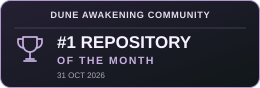

<div align="center" dir="ltr">

**English** · [简体中文](docs/readme/README_zh.md) · [繁體中文](docs/readme/README_zh-TW.md) · [日本語](docs/readme/README_ja.md) · [한국어](docs/readme/README_ko.md) · [Türkçe](docs/readme/README_tr.md) · [Русский](docs/readme/README_ru.md) · [Tiếng Việt](docs/readme/README_vi.md) · [ไทย](docs/readme/README_th.md) · [Deutsch](docs/readme/README_de.md) · [Español](docs/readme/README_es.md) · [Français](docs/readme/README_fr.md) · [Українська](docs/readme/README_uk.md) · [Polski](docs/readme/README_pl.md) · [Português (Brasil)](docs/readme/README_pt-BR.md) · [العربية](docs/readme/README_ar.md) · [فارسی](docs/readme/README_fa.md) · [Bahasa Indonesia](docs/readme/README_id.md) · [Italiano](docs/readme/README_it.md) · [Ελληνικά](docs/readme/README_el.md) · [മലയാളം](docs/readme/README_ml.md) · [Roman Urdu](docs/readme/README_ur-Latn.md) · [Română](docs/readme/README_ro.md)

</div>

# Dune: Awakening Docker - Self-Hosted Server Console

<p align="center">
  
  
  
</p>


      [](https://dunedocker.app/)

Dune Docker Console is a Docker-based Dune: Awakening dedicated server manager for Linux, Windows/WSL2, and virtual machines. It provides guided installation and a browser admin panel for managing players, maps, backups, updates, and server operations without living in the terminal.

This is an unofficial community project and is not affiliated with, endorsed by, sponsored by, or supported by Funcom.

The project is experimental, and Funcom self-hosting behavior may change over time.

## What You Can Do

- **Deploy & Operate:** Guided browser setup, updates, service controls, scheduled restarts, restart queues, diagnostics, and recovery.
- **See It Live:** Interactive world maps, player and vehicle tracking, resource locations, server health, performance, and logs.
- **Control Arrakis:** Configure maps, Sietches, Deep Desert layouts, autoscaling, memory, gameplay settings, and **experimental Regis Tanks**.
- **Manage Players:** Player and guild tools, inventories, progression, bases, storage, vehicles, Landsraad, rewards, and Care Packages.
- **Run the Economy:** Browse Exchange listings and automate trading with the built-in Market Bot.
- **Protect Your Server:** Database and encrypted system backups, restore and migration tools, access roles, scoped API keys, and encrypted API access.
- **Build & Share:** Design bases in 3D, import and share blueprints, and showcase your server with a public profile and latency checks.
- **Make It Yours:** Community Addons, Discord integration, multiple Console languages, and community translation corrections.

See the [Screenshots Gallery](docs/screenshots.md) for a closer look.

## Requirements

You do not need to be a Linux expert. The installer checks the basics and prepares Docker on supported Linux systems.

| What&nbsp;You&nbsp;Need | Recommendation |
|---|---|
| Server | A fresh 64-bit Ubuntu server is the recommended and easiest option. Other Linux distributions, Docker Desktop on Windows/WSL2, and virtual machines are also supported. |
| Docker | The installer prepares Docker on supported Linux systems if it is not already available. |
| CPU | AVX/AVX2 support |
| Memory | Start with 20 GB RAM; use 30–40 GB or more for additional always-on maps |
| Storage | 200 GB or more |
| Funcom token | Entered securely during browser setup |

On SELinux hosts such as Fedora and Bazzite, the Console configuration includes
a shared project mount label and disables SELinux label confinement only for the
Console, which needs access to the host Docker socket. Host SELinux remains enabled;
the Docker socket's labels and permissions are unchanged. After upgrading an existing
installation, run `dune console reload` to apply these settings to the Console.
Docker must already be installed if its automatic installer does not support your
distribution.

<details>
<summary>Memory & CPU Guidance</summary>

RAM determines how many Dune map servers can run comfortably. Start with the basic layout if you are unsure and add more RAM for additional always-on maps or heavier player activity.

The official Survival server commonly keeps roughly 10–12 GB resident even with no players online; a single idle snapshot is not by itself a memory leak. In `docker stats`, CPU is measured in CPU-core units: `100%` means one fully used logical CPU.

| Server Layout | Recommended RAM |
|---|---:|
| Basic server for getting started | 20 GB |
| Main world plus extra story/social maps | 30 GB |
| Main world, extra maps, and Deep Desert | 40 GB |
| Many always-on maps or heavier player activity | 60 GB+ |

</details>

For public/internet hosting, forward these ports:

| Port | Protocol | Purpose |
|---|---|---|
| `8088` | TCP | Web admin panel; allow access only for trusted administrators |
| `31982` | TCP | RabbitMQ Game Messaging Endpoint |
| `31983` | TCP | RabbitMQ Game HTTP Endpoint |
| `7777-7810` | UDP | Game Traffic |
| `32000-32015` | UDP | Optional direct public-directory latency probes; relay remains available when closed |
| `8797` | TCP | Optional encrypted API access (HTTPS); see [Encrypted API access](docs/console/encrypted-api.md) |

Keep database and internal admin ports private. Do not expose the Web UI to untrusted users.

## Installation

Run the installer from a regular user account with `sudo` access, not while logged in as `root`. The installer requests administrator access only when required.

Copy and paste this command on a fresh Linux server:

```sh
curl -fsSL https://raw.githubusercontent.com/Red-Blink/dune-awakening-selfhost-docker/main/bootstrap.sh | sh
```

The installer downloads the latest release, starts the Web UI, and tells you which address to open. Complete the remaining setup in your browser.

The default installation path is `~/dune-awakening-selfhost-docker`. To use a different Linux disk, set the complete destination explicitly:

```sh
curl -fsSL https://raw.githubusercontent.com/Red-Blink/dune-awakening-selfhost-docker/main/bootstrap.sh | DUNE_INSTALL_DIR=/mnt/dune/dune-awakening-selfhost-docker sh
```

On Windows, run the command in the supported Linux VM or Ubuntu WSL2 terminal—not PowerShell, Command Prompt, or Docker Desktop's internal shell. The bootstrap checks that the destination is writable and has space before it extracts anything; failed downloads never leave a partially overwritten installation.

On Alpine Linux, the installer uses the distribution's Docker and Docker Compose packages and starts Docker through OpenRC. If the community repository is unavailable, the installer asks before changing repository configuration.

## Public Server Directory

[DuneDocker.app](https://dunedocker.app/) helps public server owners showcase their communities and helps players find the right server. Each listing provides a live server page with status, player count, region, Sietches, personalized latency, and an optional Discord community link.

Owners can claim their listing directly from the Console Settings page to verify ownership, manage their public profile and Discord invite, and promote their server through the directory. Public listings can be enabled or disabled at any time.

Personalized latency uses UDP `32000-32015` for the fastest direct measurement. Allow this range through both the host firewall and any internet-to-DMZ firewall or NAT forwarding. Servers that do not expose the range remain compatible and automatically use the Dune Docker relay instead.

Local and LAN-only servers are never listed. For transparency, installations contribute only an anonymous server count by default—never server names, addresses, players, or settings—and this can be disabled separately in Settings.

## Base Builder

[Dune Docker Base Builder](https://blueprints.dunedocker.app/) is a browser-based 3D planning and sharing tool for Dune: Awakening bases. It lets you experiment with layouts before committing time and materials in-game, using a searchable catalog of structures and placeables with placement, snapping, rotation, collision, and claim-coverage tools.

Preview designs from different angles, switch between day and night, walk through the finished layout, and capture screenshots. Existing layouts can be imported for planning, while completed designs can be exported for future use.

Signed-in community members can save projects, choose public, unlisted, or private visibility, publish previews, explore shared community designs, and fork a published blueprint as a starting point. The Base Builder is also linked directly from the Console footer.

## Community Addons

Community Addons provide optional tools that can be installed and managed from the Web UI. Addons declare their permissions before installation, and updates preserve their settings and require approval for any new permissions.

Developers can start with the [Official Addon Template](https://github.com/Red-Blink/dune-docker-addon-template).

## Help and Documentation

- [Official Website](https://dunedocker.app/) — Project information, installation guidance, FAQ, and server directory
- [Base Builder](https://blueprints.dunedocker.app/) — Plan, preview, save, and share Dune: Awakening base layouts in 3D
- [Official Documentation](https://docs.dunedocker.app/) — Guides, feature documentation, technical references, and API documentation
- [Discord Community](https://discord.gg/duneawakeningdocker) — Support, updates, addons, and community discussion
- [Repository Documentation](docs/README.md) — Technical notes and references maintained alongside the source code
- [Support the Project](https://ko-fi.com/redblink) — Help support development, testing, and infrastructure

## Contributing

Dune Docker welcomes contributions from developers, server owners, and players. Check existing [issues](https://github.com/Red-Blink/dune-awakening-selfhost-docker/issues) and [pull requests](https://github.com/Red-Blink/dune-awakening-selfhost-docker/pulls) before starting to avoid duplicate work.

- **Report Bugs:** Include your project version, steps to reproduce, and what you expected to happen. Add relevant logs or screenshots with passwords and personal information removed.
- **Suggest Improvements:** Explain the problem your idea would solve and how it would help the community. Discuss larger changes in an issue before implementing them.
- **Submit Pull Requests:** Keep changes focused, link related issues, and explain what changed and how you tested it.
- **Help Beyond Code:** Improve documentation, test changes, create community addons, or suggest translation corrections directly from the Console.

For questions or to discuss an idea, join the [Discord Community](https://discord.gg/duneawakeningdocker).

## Credits and License

Dune Docker Console is led and maintained by RedBlink with contributions from the community. Please credit RedBlink as the original developer when sharing or redistributing the project.

**Free and open source under the [MIT License](LICENSE).**
