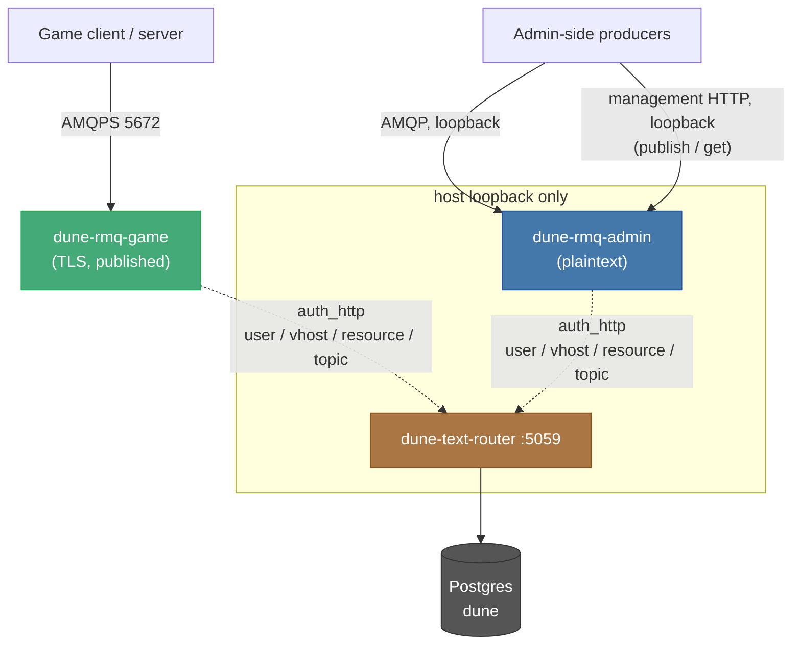

# Services Reference

**Status:** Observed — verified against game build 2168446-0-shipping (November 2026). Re-verify after a game update.

A running deployment is a dozen-plus containers. Some are defined by this
repo; most are the closed-source Funcom server image under different command
lines. [`SYSTEM-OVERVIEW.md`](SYSTEM-OVERVIEW.md) covers the ones this repo
owns — the orchestrator, the console, the metrics stack, the public probe.
This document covers the rest: the closed-source services, what each is
responsible for, and the trust boundaries between them.

**Out of scope:** the game servers themselves (Survival, Deep Desert,
Overmap, sietches) and how they are spawned, despawned and autoscaled. Those
are a moving population, not fixed infrastructure — see the autoscaler
material in [`SYSTEM-OVERVIEW.md` §1.5](SYSTEM-OVERVIEW.md#15-the-gameplay-containers-raw-docker-run-not-compose). This document is
about the services that are *always* there and hold the others up.

Related: [`DATABASE.md`](DATABASE.md) for the database every service shares,
[`WORLD-MODEL.md`](WORLD-MODEL.md) for the maps and partitions those game
servers host,
[`MULTI-SERVER-SINGLE-PUBLIC-IP.md`](../runtime/MULTI-SERVER-SINGLE-PUBLIC-IP.md)
for the authoritative host-port matrix (not repeated here).

---

## 1. Ours versus Funcom's

Two origins, and the distinction matters when something breaks — you can read
and change ours, but a closed-source service can only be configured and
observed.

| Container | Image origin | Documented in |
|---|---|---|
| `dune-orchestrator` | this repo | [SYSTEM-OVERVIEW.md §1.1](SYSTEM-OVERVIEW.md#11-the-orchestrator-container) |
| `dune-coriolis-coordinator` | this repo (orchestrator image) | [§4](#4-coriolis-coordinator-dune-coriolis-coordinator) below |
| `dune-autoscaler` | this repo (orchestrator image) | [SYSTEM-OVERVIEW.md §1.5](SYSTEM-OVERVIEW.md#15-the-gameplay-containers-raw-docker-run-not-compose) |
| `redblink-dune-docker-console` | this repo | [SYSTEM-OVERVIEW.md §1.2](SYSTEM-OVERVIEW.md#12-the-console-redblink-dune-docker-console) |
| `dune-public-probe` | this repo | [SYSTEM-OVERVIEW.md §1.4](SYSTEM-OVERVIEW.md#14-the-public-probe-opt-in) |
| `dune-postgres` | Funcom (`igw-postgres`) | [DATABASE.md](DATABASE.md) |
| `dune-rmq-game`, `dune-rmq-admin` | Funcom (`seabass-server-rabbitmq`) | [§2](#2-the-closed-source-services), [§3](#3-messaging-authorization-topology) |
| `dune-text-router` | Funcom (`seabass-server-text-router`) | [§2](#2-the-closed-source-services) |
| `dune-director` | Funcom (`seabass-server-bg-director`) | [§2](#2-the-closed-source-services) |
| `dune-server-gateway` | Funcom (`seabass-server-gateway`) | [§2](#2-the-closed-source-services) |
| game servers | Funcom (`seabass-server`) | out of scope |

The Funcom infrastructure services, Postgres included, run on the `dune-net`
bridge network. All game servers and every container from this repo use host
networking.

---

## 2. The closed-source services

### TextRouter (`dune-text-router`)

A .NET service on `dune-net`, listening on `:5059`. It is the **authorization
authority for the entire messaging layer** — see [§3](#3-messaging-authorization-topology). It also holds battlegroup
identity (region, language, display name) and its own database connection. It
is configured with the hostnames of both RabbitMQ brokers.

Because both message brokers delegate every authentication and authorization
decision to it, **TextRouter is a hard dependency for all messaging.** If it
is down or wedged, RabbitMQ rejects every login — game and admin alike — even
though the brokers themselves are healthy. A "RabbitMQ auth failing across the
board" symptom points here first, not at RabbitMQ.

### The Director (`dune-server-bg-director` → `dune-director`)

A .NET service on loopback (`127.0.0.1:11717`). Its configuration is dominated
by backend-login settings — server login secrets, username secrets, a
login-password skew tolerance — so it is the battlegroup's login/session
coordination point. It is passed the hostnames of both brokers. Loopback-only:
it is not reachable from outside the host.

### The Gateway (`dune-server-gateway`)

A Python service (`python -m service`). It holds a direct Postgres connection
and a Funcom live-services auth token, and is configured with the game
broker's *published* address and a battlegroup authorization preset. It is the
edge between connecting clients and the battlegroup's internal services. No
management port of its own.

### RabbitMQ, split in two (`dune-rmq-game`, `dune-rmq-admin`)

There are two brokers on purpose, and the split is a security boundary, not
redundancy:

| | Listener | Exposure |
|---|---|---|
| `dune-rmq-game` | **TLS only** (`listeners.tcp = none`, `listeners.ssl.default`), self-signed cert | AMQPS and management published off-host |
| `dune-rmq-admin` | plaintext AMQP **and** management HTTP | **loopback only** (both) |

Game traffic is encrypted and internet-facing; administrative traffic is
plaintext but never leaves the host. The two are not interchangeable — a
service is pointed at one or the other deliberately.

The published game-broker management endpoint is expected and documented (see
[`MULTI-SERVER-SINGLE-PUBLIC-IP.md`](../runtime/MULTI-SERVER-SINGLE-PUBLIC-IP.md));
its HTTP API enforces authentication.

Both broker configs are generated by `runtime/scripts/start-rabbitmq.sh`.

#### Why the admin broker publishes its management API

`RMQ_ADMIN_HTTP_PORT` (default 32574) maps the admin broker's 15672 onto
loopback. It exists so the state publishers can reach the management API
directly, through `runtime/scripts/lib/rabbitmq.sh`, instead of running
`docker exec dune-rmq-admin rabbitmqadmin`.

This is not a new privilege: `rabbitmqadmin` is itself only an HTTP client for
that same API, authenticating as the same battlegroup administrator against the
same TextRouter-backed auth backend (§3). What changes is the number of
processes. `publish-sietch-overrides.sh` polls its filter queue every
`FORWARD_POLL_SECONDS` whether or not anything is waiting, and both publishers
publish once per payload; every one of those execs left a `conmon` pair resident
for the engine's exit delay. It is the same trade `lib/postgres.sh` makes for
queries, for the same reason, and the seam keeps the exec as its fallback so a
host whose broker predates the port mapping still works. Only `publish` and
`get` are translated — the route-setup verbs run rarely enough that an exec
costs nothing, and they stay on it.

The listener is bound to 127.0.0.1, so the admin broker's exposure is unchanged.

#### Why the game broker publishes one too

`RMQ_GAME_LOCAL_HTTP_PORT` (default 15672) is the loopback mirror of the game
broker's management endpoint, and predates this: it exists so host-side callers
have an address that does not move when `RMQ_GAME_HTTP_PORT` is remapped.
`lib/rabbitmq.sh` polls it for one question — which game servers are connected
and running — through `dune_rmq_game_connections`.

That question used to be `docker exec dune-rmq-game rabbitmqctl list_connections
user state`, asked from three places: `ready.sh` on every 30-second ready sweep
(retrying once), `status.sh` per run, and `publish-sietch-overrides.sh` every
`SNAPSHOT_REFRESH_SECONDS` (default 10). Together they were the largest standing
source of container execs on an otherwise idle farm.

Unlike the `rabbitmqadmin` verbs above, this one needs credentials — `rabbitmqctl`
authenticates with the Erlang cookie, the HTTP API does not — and finding them
must not itself cost an exec, or the trade is a wash.

The distinction that matters is between `docker exec`, which spawns a conmon
pair, and `docker logs`, which reads the engine's log and starts no process in
the container. Only the first is what this seam exists to remove. The lookup
tries `runtime/text-router/director-current.log` first, then falls through to
`docker logs dune-director`, reading line by line and stopping at the first
match — the announcement is the nineteenth line the director writes, so it
stops after about a kilobyte. The result is cached per process.

The file is tried first because it is free, but it usually misses: it is a
`tail -n 4000` of a log inside `dune-text-router`, and the credentials are
announced once at director startup, so they scroll out of the window within
minutes. A first version of this seam read only that file, on the theory that
any engine call was too expensive, and the result was a seam that declined
every time on a live host while the callers went on execing exactly as before.

Anything that goes wrong — no `curl`, no published port, no credentials in
either source, a non-2xx answer — returns `RMQ_HTTP_UNSUPPORTED` and the caller
runs the `rabbitmqctl` it always ran. A 401 is included in that, because
credentials rotate and there is nothing fresher to re-read, while the
cookie-authenticated exec still works.

---

## 3. Messaging authorization topology

The single most load-bearing fact about the services: **neither broker
authenticates against its own user database.** Each config sets exactly one
auth backend — a 5-second cache in front of an HTTP backend pointed at
TextRouter — with no `internal` fallback. Every decision (user, vhost,
resource, topic) is TextRouter's.

Two consequences fall out of this design:

- **The image's default `guest` user is inert.** It still appears in
  `rabbitmqctl list_users`, but because the internal database is never a
  configured backend, `guest` cannot authenticate — a login attempt is
  "Denied by the backing HTTP service." Its presence is cosmetic, not a
  standing credential.
- **There is no static broker username/password in this repo.** The scripts
  pass neither `RABBITMQ_DEFAULT_USER` nor `RABBITMQ_DEFAULT_PASS`; the
  credentials services actually use are minted and validated at TextRouter
  against the database.

---

## 4. Coriolis coordinator (`dune-coriolis-coordinator`)

Ours, built from the orchestrator image. It tails the game log for the signal
`LogCoriolis: Display: Coriolis Restart Farm` (polling every 2s by default)
and, on seeing it, drives the Deep Desert reset: it runs
`restart-game-farm.sh` and `coriolis-data-cleanup.sh`, holding a lock file so
two resets cannot overlap. It is the bridge between an in-game reset event and
the host-side restart it requires.

---

## 5. Startup order

`runtime/scripts/start-all.sh` is the source of truth, and the real sequence
is longer than a simple dependency chain — roughly sixteen steps, not the
handful the dependency order implies. The infrastructure-bringup portion, in
order:

1. Postgres
2. schema update (`update-db.sh`)
3. map-catalog refresh and world-partition reconciliation
4. spice-field overrides, public-IP sync, network-advertisement reconciliation
5. sietch-state sync, stale-world-server recycling
6. RabbitMQ (both brokers)
7. TextRouter
8. Director
9. the always-on world servers (Survival, Overmap) — out of scope here

The ordering constraint that matters: **RabbitMQ starts before TextRouter,
but neither can authenticate a client until TextRouter is up** ([§3](#3-messaging-authorization-topology)), and the
Director starts after both brokers because it connects to them.

`runtime/scripts/stop-all.sh` tears the stack down; each service also has its
own `start-*.sh`.

---

## 6. Failure-to-symptom map

| Symptom | Look first at |
|---|---|
| RabbitMQ auth failing for everything, brokers otherwise healthy | TextRouter down/wedged ([§3](#3-messaging-authorization-topology)) |
| Clients cannot connect but internal services are fine | Gateway, or the game broker's TLS/published port |
| Login/session problems specific to a battlegroup | Director |
| A Deep Desert reset event fires in-game but the host never restarts | Coriolis coordinator ([§4](#4-coriolis-coordinator-dune-coriolis-coordinator)) |
| A published game-broker management port is unreachable | host firewall / port mapping — see [MULTI-SERVER-SINGLE-PUBLIC-IP.md](../runtime/MULTI-SERVER-SINGLE-PUBLIC-IP.md) |
| A player sits in an endless login queue after logging out inside Deep Desert | [Deep Desert login queue](#deep-desert-login-queue) below |

### Deep Desert login queue

Deep Desert servers are on-demand and despawn when idle. A player who logged out inside a Deep Desert
dimension and logs back in after that dimension's server despawned is refused by the Director and
queued for a partition that has no server. The Director logs, once per login attempt,
`Player <FLS id> requested WorldPartition {...}. Teleport not allowed, returning to WorldPartition { PartitionId = N, ServerId = , Map = DeepDesert_1, ...`,
and `Failed to process travel queue for partition N` about once a second.

The autoscaler starts that partition itself: it reads the refusal, checks that partition `N` has no live
server and no container, and runs `spawn-server.sh N`. Look in the autoscaler log for
`SPAWN deepdesert-login-resume partition=N player=<FLS id>`, then `DONE ... rc=0` (the script finished; it also
exits 0 when a spawn for that partition was already in progress) or `ERROR failed to spawn ... rc=<code>`.
`SKIP deepdesert-login-resume ... reason=map-disabled` means Deep Desert is disabled;
`reason=container-present-unbound` means no spawn is running, yet a container for the partition exists and is not
bound to it (a spawn that did not finish binding), which needs an operator (`docker logs dune-server-deepdesert-1-N`, then `dune despawn N` and `dune spawn N`).

What the player does: the spawn takes about a minute. If the loading screen times out first, wait a minute and log in
again. The server then exists and the Director routes the login normally. If it never starts, `dune spawn N` starts the
partition by hand. A refusal that was not seen within 150 seconds (the autoscaler's log follower was down, for example)
is recovered by the player's next login attempt. Each Deep Desert partition costs 16 GB of memory while it runs.
